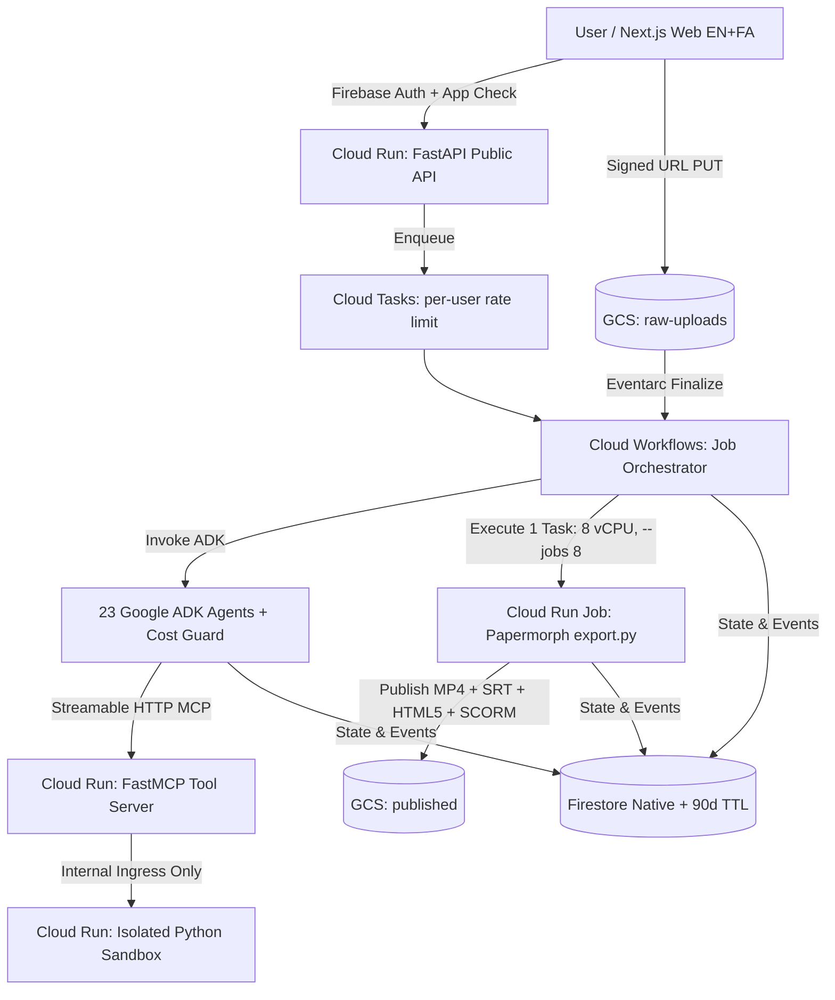

# System Architecture

## Rendering Design
- **Single Cloud Run Job Task (`8 vCPU`, `--jobs 8`, no GPU)**: `services/render-job` packages the upstream `amirxoo13/Papermorph` repository under `/app/vendor/papermorph`. A single 8-vCPU task starts `serve.py` locally and runs `.claude/skills/papermorph/scripts/export.py --jobs 8`, which launches 8 parallel headless browsers (`frame f % 8`) and streams frames into `ffmpeg` in order.
